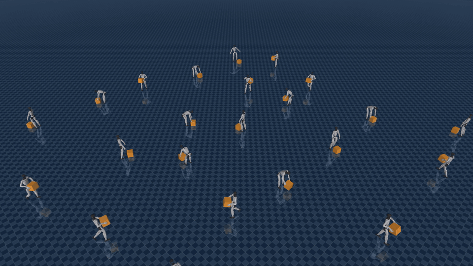

<h1 align="center">Isaac Sim + Isaac Lab in Pixi</h1>

<p align="center">
  <a href="https://github.com/isaac-sim/IsaacSim"></a>
  <a href="https://github.com/isaac-sim/IsaacLab"></a>
  <a href="https://pixi.sh"></a>
  <a href="https://www.python.org"></a>
  <a href="https://pytorch.org"></a>
  <a href="#1-requirements"></a>
  <a href="#1-requirements"></a>
  <a href="LICENSE"></a>
</p>

<p align="center">
  
</p>

<p align="center"><b><i>Reproducible NVIDIA Isaac Sim and Isaac Lab, locked in a Pixi environment. No conda, no pip install.</i></b></p>

---

A reproducible [Pixi](https://pixi.sh) environment for NVIDIA Isaac Sim 6.0.1 on Python 3.12, with the CUDA 12.8 build of PyTorch.

CUDA 12.8 is the minimum your NVIDIA driver must support, not the version it has to report. `nvidia-smi` shows the newest CUDA the driver supports (13.2 for driver 595), and any driver reporting 12.8 or newer runs this environment. See [8.1](#81-switching-to-the-cuda-13-build-of-pytorch) to use a CUDA 13 build of PyTorch instead.

Isaac Lab v3.0.0-beta2 is available as a **separate, optional environment**. Install it only if you want reinforcement learning. See [section 5](#5-isaac-lab).

---

## Contents

1. [Requirements](#1-requirements)
2. [Install Isaac Sim](#2-install-isaac-sim)
3. [Verify](#3-verify)
4. [Daily use](#4-daily-use)
5. [Isaac Lab](#5-isaac-lab)
6. [Uninstall](#6-uninstall)
7. [Troubleshooting](#7-troubleshooting)
8. [Reference](#8-reference)
9. [License](#9-license)

---

## 1. Requirements

| | |
| --- | --- |
| OS | Linux with **glibc ≥ 2.35**. Tested on Ubuntu 22.04 and Ubuntu 24.04 |
| GPU | NVIDIA, recent driver (tested on: 580.178.04 on 22.04 and 595.99.02 on 24.04, RTX 4070 Laptop, 8 GB) |
| Graphics | Working Vulkan stack: `libvulkan1` + the NVIDIA ICD, and an X11 session (see [No window or a broken window](#no-window-or-a-broken-window-on-wayland)) |
| Disk | ~26 GB for Isaac Sim, ~2 GB more for Isaac Lab, plus download cache |
| Tools | `git` |


Vulkan comes from your system driver, not from Pixi. On Ubuntu:

```bash
sudo apt install libvulkan1
```

---

## 2. Install Isaac Sim

#### 2.1 Install pixi

Skip if `pixi --version` already works.

```bash
curl -fsSL https://pixi.sh/install.sh | sh
```

This installs to `~/.pixi/bin` and adds it to your shell profile. Open a new terminal, or load it into the current one:

```bash
export PATH="$HOME/.pixi/bin:$PATH"
```

#### 2.2 Get this project

```bash
git clone https://github.com/Chandan-kumar-R/isaac-pixi.git
cd isaac-pixi
```

All commands below are run from this directory.

#### 2.3 Fetch the Isaac Lab sources

```bash
bash scripts/bootstrap.sh
```

Clones Isaac Lab at the pinned tag into `./IsaacLab`, about 150 MB, using only `git`. **This does not install Isaac Lab.**

> Required even if you only want Isaac Sim. Pixi resolves every environment in the manifest, so the sources must be on disk before the next step. Skipping it makes `pixi install` fail with `error while canonicalization .../IsaacLab/source/isaaclab`.

#### 2.4 Install Isaac Sim

```bash
pixi install
```

Installs Isaac Sim, PyTorch and ~200 other packages into `.pixi/envs/default`. Expect **20–45 minutes** and ~26 GB on the first run; downloads are cached, so later installs take minutes.

> Isaac Lab is **not** installed by this step. That is [section 5](#5-isaac-lab).

> No `conda create`, no `pip install`, no `isaaclab.sh --install`, no activation step.

---

## 3. Verify

```bash
pixi run doctor
```

> This checks GPU, driver, glibc, Vulkan, torch+CUDA and the installed packages. Everything should read `OK`:

```
GPU / driver
  OK    NVIDIA GeForce RTX 4070 Laptop GPU, 595.99.02, 8188 MiB
System libraries
  OK    glibc 2.39 (wheels require >= 2.35)
  OK    Vulkan loader present
  OK    NVIDIA Vulkan ICD present
Python environment
  OK    libstdc++ from the environment provides CXXABI_1.3.15
  OK    torch 2.11.0+cu128
  OK    CUDA available: NVIDIA GeForce RTX 4070 Laptop GPU
  OK    isaacsim 6.0.1.0
```

Any `FAIL` makes the command exit non-zero. `pixi run -e lab doctor` runs the same checks in the Isaac Lab environment and adds an `isaaclab` line.

Then confirm the simulator actually runs and steps physics:

```bash
pixi run smoke
```

Takes a few minutes on first run while shaders compile. It should end with `smoke test passed`.

---

## 4. Daily use

```bash
pixi run isaacsim
```

> **First launch takes several minutes** while Isaac Sim builds its shader and extension caches, and a dialog that looks like an error appears. **Do not click it, just wait.**

### Tasks

| Command | What it does |
| --- | --- |
| `pixi run isaacsim` | Launch the Isaac Sim GUI |
| `pixi run isaacsim-headless` | Launch with no window (training / SSH / CI) |
| `pixi run doctor` | Check GPU, driver, Vulkan and the install |
| `pixi run smoke` | Headless test that physics steps |

- Isaac Lab adds three more tasks, in its own environment. See [5.4](#54-tasks-added-by-this-environment).

- Extra arguments pass through to Kit:

```bash
pixi run isaacsim --/app/window/width=1920
```

### Running your own code

`pixi run` activates the environment for one command:

```bash
pixi run python my_script.py
```

>For an interactive session, `pixi shell`. Both get identical setup; the graphics and C++ ABI configuration lives in `scripts/activate.sh`, not in any single task.

---

## 5. Isaac Lab

>Isaac Lab adds the tasks, the RL library wrappers and the training scripts. It lives in its own pixi environment, so you install it only when you want it.

#### 5.1 Install it

```bash
pixi install -e lab
```

Install into `.pixi/envs/lab`. The sources are already in place from [step 2.3](#23-fetch-the-isaac-lab-sources); if you deleted them, re-run `bash scripts/bootstrap.sh` first.

#### 5.2 It cannot break your Isaac Sim install

This is the point of the separate environment:

| | |
| --- | --- |
| `.pixi/envs/default` | Isaac Sim only |
| `.pixi/envs/lab` | Isaac Sim + Isaac Lab |

They are **separate directories**. Installing, upgrading or wrecking `lab` cannot modify `default` — not a convention, just two different prefixes on disk. If `lab` ever goes wrong, `pixi clean -e lab` and your simulator is untouched.

> A shared solve-group keeps Isaac Sim, PyTorch and all common packages at identical versions in both, so switching environments never changes your simulator underneath you.

Both still resolve through pixi rather than pip, so the failure mode that `isaaclab.sh --install` caused cannot happen either.

> Do not run `./isaaclab.sh --install` inside these environments. It pip-installs over the locked packages instead of resolving them. If you ever do, `pixi clean -e lab && pixi install -e lab` restores the environment.

#### 5.3 Use it

Every `lab` command takes `-e lab`:

```bash
pixi run -e lab tasks-list
pixi run -e lab tasks-list spot
```

Or drop into it for a session:

```bash
pixi shell -e lab
```

#### 5.4 Tasks added by this environment

| Command | What it does |
| --- | --- |
| `pixi run -e lab isaaclab <args>` | Run an Isaac Lab script (`train`, `play`, tutorials) |
| `pixi run -e lab tasks-list [filter]` | List registered gym environments |
| `pixi run -e lab isaaclab-clone` | Re-sync the checkout to the pinned tag |

- The `default` environment does not define these, so running them without `-e lab` fails loudly instead of half-working.

- `isaaclab` takes `train`, `play`, or the path to any script, relative to `IsaacLab/` or to this repository. `train` and `play` are Isaac Lab 3.0's combined entry points, so they need `--rl_library`:

```bash
# Train, headless (the default in Isaac Lab 3.0)
pixi run -e lab isaaclab train --rl_library rsl_rl --task Isaac-Velocity-Flat-Anymal-D-v0

# Play the latest checkpoint, with the Isaac Sim viewport
pixi run -e lab isaaclab play --rl_library rsl_rl --task Isaac-Velocity-Flat-Anymal-D-v0 --viz kit

# Any other script, e.g. a tutorial
pixi run -e lab isaaclab scripts/tutorials/00_sim/create_empty.py --viz kit
```

Training logs land in `logs/` in this directory, which git ignores.

#### 5.5 Remove just Isaac Lab

```bash
pixi clean -e lab
```

---

## 6. Uninstall

Three levels, smallest first. Each is independent, stop wherever you like.

#### 6.1 Remove one environment

From the project directory:

```bash
pixi clean -e lab       # Isaac Lab only, leaves Isaac Sim working
pixi clean -e default   # Isaac Sim only, ~26 GB
pixi clean              # both
```

`pixi install` (or `pixi install -e lab`) rebuilds from the lock.

#### 6.2 Remove the download and runtime caches

Everything here is re-downloadable.

```bash
# pixi's package download cache
pixi clean cache --yes

# Isaac Sim / Omniverse shader, asset and extension caches
rm -rf ~/.cache/ov ~/.nvidia-omniverse ~/.local/share/ov ~/.cache/warp
```

`pixi clean cache` is shared across all your pixi projects. It deletes only downloaded archives, not installed environments.

---

## 7. Troubleshooting

#### Messages that are normal

| Message | Meaning |
| --- | --- |
| A dialog that looks like an error on first launch | Shader/extension cache being built. Do not click it. |
| `mdl_list_cache is not complete` | First-run material cache warming. |

#### No window appears

Isaac Lab 3.0 runs **headless by default**. Opt in to a window with `--viz kit`, not `--headless` (which is deprecated and means the opposite of what you would guess).

#### No window or a broken window on Wayland

Ubuntu 24.04 logs into a Wayland session by default. Isaac Sim's GUI then runs through XWayland, and windows can come up black, flicker, or not appear. Check your session:

```bash
echo $XDG_SESSION_TYPE
```

If it prints `wayland`, log out, click the gear icon on the login screen and pick **Ubuntu on Xorg**. Headless runs (`smoke`, training) are not affected.

#### Driver version warning on startup

Isaac Sim may warn that your driver version is not verified. Newer drivers than NVIDIA's recommended one usually work: if `pixi run smoke` passes, the warning can be ignored.

#### Isaac Sim crashes on startup

Run `pixi run doctor` first. If that is clean, check that the NVIDIA Vulkan ICD is being selected:

```bash
pixi run bash -c 'echo $VK_DRIVER_FILES'
```

It should print `/usr/share/vulkan/icd.d/nvidia_icd.json`. If empty, no NVIDIA ICD was found and the loader may be falling back to a software driver.

#### `error while canonicalization .../IsaacLab/source/isaaclab`

Any pixi command fails with this when `IsaacLab/` is absent, including `pixi install` for the default environment:

```bash
bash scripts/bootstrap.sh
```

#### `Failed to create any GPU devices`

Another Isaac Sim process is already holding the GPU. Check with `nvidia-smi` and stop it.

---

## 8. Reference

#### 8.1 Switching to the CUDA 13 build of PyTorch

Recent drivers report CUDA 13.x (580 reports 13.0, 595 reports 13.2) and run the cu128 build fine. For cu130 wheels, edit the `torch` line in `pixi.toml`:

```toml
torch = { version = "==2.14.1", index = "https://download.pytorch.org/whl/cu130" }
```

Then re-run `pixi lock`.

#### 8.2 What is installed

| | |
| --- | --- |
| Python | 3.12  |
| PyTorch | 2.11.0+cu128, with torchvision and torchaudio |
| Isaac Sim | 6.0.1.0, `all` + `extscache` |
| Isaac Lab | v3.0.0-beta2 |
| RL | rsl_rl, skrl `lab` environment only |

#### 8.3 The two environments

| | `default` | `lab` |
| --- | --- | --- |
| Prefix | `.pixi/envs/default` | `.pixi/envs/lab` |
| Isaac Sim | yes | yes |
| Isaac Lab | no | yes |
| Install | `pixi install` | `pixi install -e lab` |

---

## 9. License

This repository (the pixi manifest, the scripts and this README) is licensed under the [Apache License 2.0](LICENSE).

It does not contain Isaac Sim or Isaac Lab. Those are downloaded during setup and come under their own licenses:

| | |
| --- | --- |
| Isaac Sim | Installed by `pixi install` from NVIDIA's package index, under NVIDIA's license terms |
| Isaac Lab | Cloned by `scripts/bootstrap.sh` from [isaac-sim/IsaacLab](https://github.com/isaac-sim/IsaacLab), BSD-3-Clause |

`pixi.toml` sets `OMNI_KIT_ACCEPT_EULA=YES` so the first launch does not stop at a license prompt. Using this environment therefore means you accept NVIDIA's Omniverse license agreement. Read it before you install.
